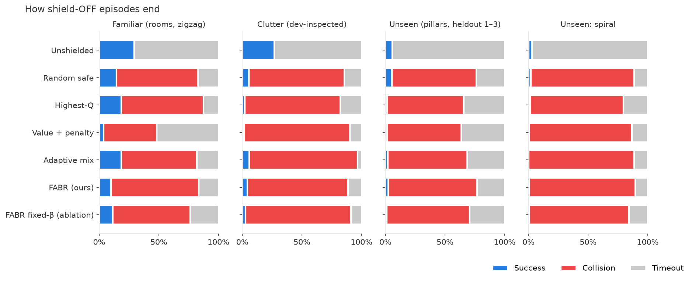
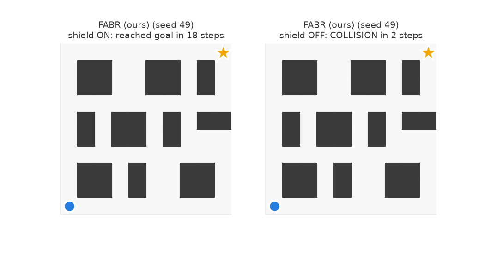

# FABR: Feedback-Adaptive Boltzmann Replacement for shielded RL

MSML635 final project. Team: Abhiram Metuku, Sai Malkireddy, Sriram Vema.

**Question.** When a safety shield blocks an RL agent's unsafe action, it has to execute *some*
safe action instead. Does the choice of replacement change what the agent learns, and whether it
can navigate safely once the shield is removed?

**FABR (our method).** FABR samples the replacement from a softmax over the Q-values of the safe
actions, with inverse temperature β = 4·(1 − r)², where r is the recent rate at which the agent's
greedy action is unsafe. While the agent still proposes unsafe moves, replacements explore the
safe alternatives. As it learns, they focus on the best safe action. See
[docs/METHODS.md](docs/METHODS.md) for the full definition and
[docs/RELATED_WORK.md](docs/RELATED_WORK.md) for how it differs from shielding and ADVICE.

## Quickstart

```bash
python -m venv .venv && source .venv/bin/activate
python -m pip install -r requirements.txt
python -m pytest -q tests                      # ~45 s

# 1. Train + evaluate all 7 methods x 10 seeds, in both training settings (resumable:
#    rerun the same command after an interruption). About 3.5 h for both on a laptop.
SEEDS="42 43 44 45 46 47 48 49 50 51"
python run_experiments.py --steps 50000 --seeds $SEEDS --jobs 4 --output results/final_cf
python run_experiments.py --steps 50000 --seeds $SEEDS --jobs 4 --no-collision-feedback --output results/final_no_cf

# 2. Figures -> results/<setting>/figures/
python plots.py --results results/final_no_cf

# 3. Animated demo: one trained agent with the shield ON vs OFF on an unseen map
python demo.py --results results/final_no_cf --methods fabr --seed 49 --layout pillars --start 9 0
```

To train or evaluate one model:

```bash
python train.py --method fabr --steps 50000 --seed 42 --output results/one
python evaluate.py --model results/one/fabr_seed42.pt
```

## Methods compared

All methods use Double DQN with the same network, budget, seeds and training maps. Only the
replacement rule differs (`replacement.py`).

| Method | When the proposal is unsafe, execute… |
|---|---|
| `unshielded` | the unsafe action (no shield) |
| `random_safe` | a random safe action |
| `highest_q` | the highest-Q safe action |
| `value_penalty` | the highest-Q safe action, with a −1 training penalty per intervention |
| `adaptive_mix` | random or highest-Q, with P(random) = recent unsafe-proposal rate |
| **`fabr`** | **a Boltzmann sample over safe Q-values, with β adapted to the greedy unsafe rate** |
| `fabr_fixed` | ablation: the same sampling with β fixed at FABR's average β |

**Training** uses rooms, zigzag and 100 generated random maps, with every reachable start, so the
agent cannot memorise one map. **Evaluation** is shield-off and greedy, run from every reachable
start of 8 frozen maps (581 episodes). The maps are grouped as familiar (rooms, zigzag), clutter
(development), unseen (pillars, heldout_1–3) and spiral (unseen, reported separately). See
[docs/EVALUATION_PROTOCOL.md](docs/EVALUATION_PROTOCOL.md).

## Results

7 methods × 10 seeds (42–51) × 50,000 steps, in two training settings that differ only in
what a shielded agent learns from a blocked action:

- **Collision feedback (`cf`)**: the blocked proposal is also stored as a collision
  (reward −10, terminal), so the agent learns what the wall would have done.
- **No collision feedback (`no_cf`)**: the agent only learns from the action that was executed.

Evaluation: shield OFF, greedy, 581 frozen scenarios. Cells show **success / collision** rate,
as the mean over 10 seeds. 95% CIs, per-layout results and FABR-vs-baseline paired differences
are in [`docs/results/`](docs/results/). Unshielded is the same in both settings, because it
has no interventions.

**With collision feedback**

| Method | Familiar | Clutter | Unseen | Spiral |
|---|---|---|---|---|
| Unshielded | 29% / 0% | 27% / 0% | 6% / 0% | 3% / 0% |
| Random safe | 16% / 0% | 11% / 0% | 8% / 0% | 1% / 0% |
| Highest-Q | 19% / 0% | 19% / 0% | 8% / 0% | 2% / 0% |
| Value + penalty | 13% / 0% | 18% / 0% | 6% / 0% | 3% / 0% |
| Adaptive mix | 13% / 0% | 21% / 0% | 6% / 0% | 3% / 0% |
| **FABR** | 20% / 0% | 16% / 0% | 8% / 0% | 2% / 0% |
| FABR fixed-β | 19% / 0% | 19% / 0% | 9% / 0% | 3% / 0% |

**Without collision feedback**

| Method | Familiar | Clutter | Unseen | Spiral |
|---|---|---|---|---|
| Unshielded | 29% / 0% | 27% / 0% | 6% / 0% | 3% / 0% |
| Random safe | 14% / 68% | 5% / 80% | 5% / 71% | 2% / 87% |
| Highest-Q | 18% / 69% | 2% / 80% | 1% / 65% | 1% / 78% |
| Value + penalty | 4% / 44% | 2% / 89% | 1% / 62% | 0% / 86% |
| Adaptive mix | 19% / 64% | 6% / 91% | 2% / 66% | 0% / 88% |
| **FABR** | 10% / 73% | 4% / 84% | 2% / 75% | 1% / 89% |
| FABR fixed-β | 11% / 65% | 3% / 88% | 1% / 69% | 1% / 83% |

Any episode that is neither a success nor a collision is a timeout: the greedy policy loops
until the 100-step limit.

### What the results show

1. **The replacement rule makes no significant difference.** FABR is not significantly better
   than any baseline on shield-off success in either setting. Every paired 95% CI on FABR's
   success difference against another shielded method contains zero
   ([`paired.csv`](docs/results/no_cf/paired.csv)). The one significant difference goes the
   other way: without collision feedback, FABR is worse than unshielded on familiar maps
   (−20 ± 13 pp).
2. **Feedback about blocked actions matters far more than which safe action replaces them.**
   - Without it, shielded agents never see a collision, so once the shield is removed they hit
     walls in 62–91% of episodes. This is the "dependence on the shield" the project set out
     to measure.
   - With the counterfactual, no method collides shield-off.
   - The demo shows this directly: with the shield on, the `no_cf` FABR agent takes the
     shortest path (5 interventions). With the shield off, it hits a wall in 2 steps.
3. **The ablation: adaptation vs. a fixed temperature.**
   - *With collision feedback*, the greedy policy stops proposing unsafe moves within about
     2,000 steps, so FABR's β saturates at β_max = 4 and FABR becomes the fixed-β ablation
     ([figure](docs/results/cf/figures/fabr_beta.png)).
   - *Without collision feedback*, β does adapt (between about 2.4 and 3.1;
     [figure](docs/results/no_cf/figures/fabr_beta.png)). Even so, FABR minus fixed-β
     (β = 2.66) is +1.2 ± 2.4 pp unseen success and +5.1 ± 10.3 pp unseen collision. Neither
     difference is significant.
4. **Some baselines collide less than FABR.** Without collision feedback, FABR collides more
   than value + penalty on familiar maps (+29 ± 14 pp, 9/10 seeds) and on unseen maps
   (+12 ± 9 pp). On unseen maps it also collides more than highest-Q (+10 ± 10 pp).
5. **Absolute performance is low, and the unshielded agent does best shield-off.**
   - It learns to avoid walls from its own collisions: 81% of its training episodes end in
     one.
   - All agents generalise poorly to unseen maps (≤ 9% success). Most failures are timeouts.
     A 50k-step DQN trained on 102 maps learns safety but not general navigation.

| | |
|---|---|
|  |  |

### Limitations

- One environment family (10×10 grids with an exact, deterministic shield).
- One budget (50k steps), with no hyperparameter search per method.
- Training is not long enough for strong navigation on unseen maps.
- β_max = 4 bounds how greedy FABR can be. FABR's schedule depends on the greedy unsafe rate,
  and the collision counterfactual drives that rate to zero almost immediately.

## Repository layout

```
environment.py        GridWorld, the named maps, generated training pool
replacement.py        all replacement strategies (incl. FABR)
dqn.py                Double DQN and the Q-networks
train.py              training loop (one configuration for every method)
evaluate.py           shield-off evaluation on the frozen scenario set
run_experiments.py    train + evaluate + aggregate all methods and seeds
plots.py, demo.py     figures and the shield ON/OFF animation
make_eval_scenarios.py, evaluation_scenarios*.json, configs/holdout_suite/   frozen evaluation set
tests/                unit and end-to-end tests
docs/                 methods, evaluation protocol, related work; docs/results/ = final tables + figures
archive/              earlier experiments, scripts, reports and results (kept for history; not used)
```
