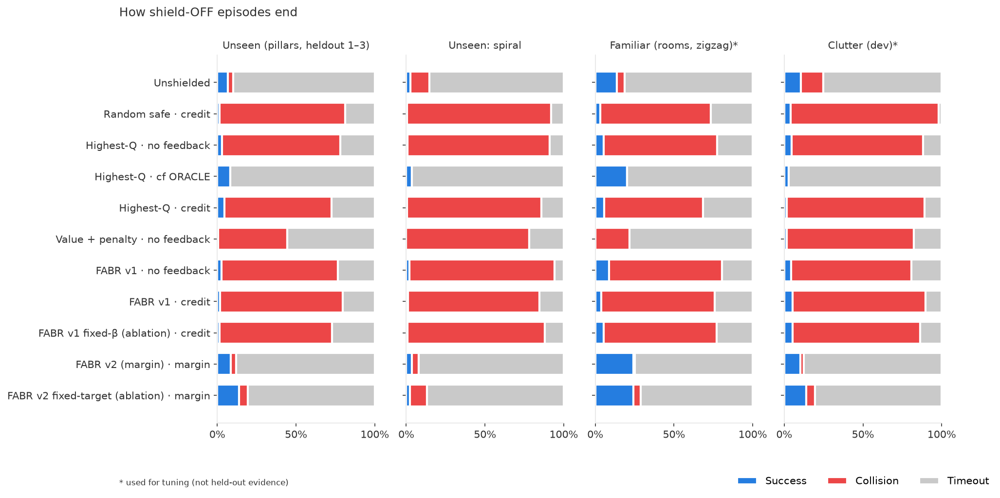
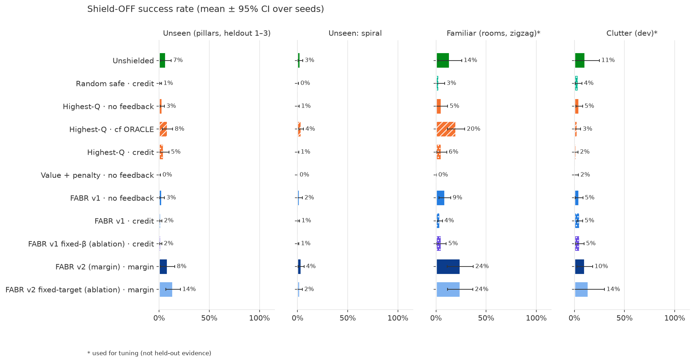

# FABR: replacement and feedback for shielded RL

MSML635 final project. Team: Abhiram Metuku, Sai Malkireddy, Sriram Vema.

**Question.** When a safety shield blocks an RL agent's unsafe action, it has to execute *some*
safe action instead, and the agent has to learn *something* from the blocked proposal. Do these
choices change what the agent learns, and whether it can navigate safely once the shield is
removed?

- **FABR v1** (the motivating negative result) samples the replacement from a softmax over
  safe Q-values, with β = 4·(1 − r)² set by the greedy unsafe rate r. At 50k steps it does not
  beat simple baselines ([v1 results](#v1-results-50k-steps-motivating)).
- **FABR v2** (`fabr_v2`) executes the highest-Q safe action and adds a large-margin loss on
  the blocked proposal: relu(Q(s,a_prop) − max_safe Q(s,·) + m). It uses only "this action was
  blocked", never the outcome of an action that was not executed.

**Main result** (10 seeds, unseen maps, shield off; [details](#results-v2-frozen-protocol)).
FABR v2 removes shield dependence without an oracle:

- Shield-off collisions fall from 75.0% (same agent without the margin loss) to **3.4%**:
  −71.5 ± 9.5 pp, lower on 10/10 seeds.
- That is close to the oracle counterfactual (0.0%) but not equal to it: +3.4 ± 2.7 pp.
- It beats the tuned intervention penalty on both collisions and success.
- It is **not** better than the unshielded agent.
- It does **not** beat its own fixed-target ablation.
- Absolute success stays low (≤ 14% on unseen maps); most failures are timeout loops.

See [docs/METHODS.md](docs/METHODS.md) for definitions and
[docs/RELATED_WORK.md](docs/RELATED_WORK.md) for how this relates to shielding, DQfD and ADVICE.

## For graders: about 40 minutes

```bash
./grade.sh              # creates .venv, then runs: smoke, verify, quick
./grade.sh --no-quick   # smoke + verify only (~10 min)
```

| Command | What it does | Time* |
|---|---|---|
| `smoke` | the full test suite (unit + tiny end-to-end) | ~1 min |
| `verify` | **exact reproduction**: re-evaluates all 110 shipped checkpoints in `docs/results/v2/core/`; every one of the 63,910 episodes must match, every outcome rate exactly | ~8 min |
| `quick` | **sanity check of direction, not a reproduction**: retrains the 5 headline configs × 3 seeds on your machine | ~30 min |

\*Measured on an 8-core M1 laptop with 6 parallel jobs. Every command resumes after an
interruption: rerun it.

**Exact vs. directional.** All 110 reported runs were trained on UMD's Zaratan cluster (AMD EPYC
7763, Python 3.10, torch 2.14.1+cpu). Two checks back this up:

- **Same platform:** training is bit-reproducible. Two final runs (`highest_q@none` and
  `fabr_v2@margin`, seed 42) were retrained from scratch on a different Zaratan node, and their
  training CSV, checkpoint and evaluation were identical (`cluster/check_determinism.py`).
- **Across platforms:** evaluation is reproducible. `verify` on an M1 Mac (Python 3.14, torch
  2.15) reproduced all 63,910 episodes exactly. Only float averages (mean reward) differ, by about
  1e-15, because Python ≥ 3.12 sums floats differently; `verify` allows 1e-9 for those.

Training is *not* bit-reproducible across CPUs or torch versions. So `verify` is the exact
reproduction, and `quick` only checks that the pattern holds, i.e. which configs collide
shield-off.

## Full pipeline

All final settings come from **one frozen file**, [`configs/final_protocol.json`](configs/final_protocol.json).
`run_experiments.py --protocol` rejects any training flag, and every run records the protocol's
sha256.

```bash
python reproduce.py tune                          # dev-map tuning, rounds 1 + 2 → docs/TUNING.md
python reproduce.py core --seeds 42 43 44 45 46   # reported results, batch 1           (~1.5 h)
python reproduce.py core --seeds 47 48 49 50 51   # batch 2 + all fabr_fixed@credit     (~1.9 h)
python reproduce.py full                          # optional: all 21 configs            (~6.5 h)
python reproduce.py figures --results results/core
python reproduce.py ship core                     # copy into docs/results/v2/core
```

On Zaratan (the reported runs; SU = core-hours): `sbatch cluster/zaratan_core.sh`. It used 25
cores for 28 min, 11.8 SU. `sbatch cluster/zaratan_determinism.sh` re-checks 2 runs (0.3 SU).
`cluster/env.sh` keeps the venv, caches and temp files inside the project folder.

One run, by hand:

```bash
python train.py --method fabr_v2 --n-step 3 --steps 100000 --seed 42 --output results/one
python train.py --method highest_q --feedback-mode credit --output results/one
python evaluate.py --model results/one/fabr_v2_seed42.pt
```

## What is compared

**Feedback mode:** what a shielded agent stores about a blocked proposal a_prop (`train.py`).

| Mode | Stored | Notes |
|---|---|---|
| `none` | (s, a_exec, r, s') only | the agent never sees the outcome of an unsafe action |
| `cf` | also (s, a_prop, −10, terminal) | **ORACLE**: uses the outcome of an action that was never executed (Alshiekh et al. 2018, option 1) |
| `credit` | (s, a_prop, r, s') *instead*, with r, s' from the replacement | Alshiekh et al. option 2. Here the replacement rule decides what Q(s, a_prop) learns |
| `margin` | (s, a_exec, r, s') + (s, a_prop) for the margin loss | FABR v2 only |

**Replacement rule:** what the shield executes instead (`replacement.py`).

| Method | When the proposal is unsafe, execute… |
|---|---|
| `unshielded` | the unsafe action (no shield) |
| `random_safe` | a random safe action |
| `highest_q` | the highest-Q safe action |
| `value_penalty` | highest-Q, with a tuned training penalty per intervention |
| `adaptive_mix` | random or highest-Q, with P(random) = recent unsafe-proposal rate |
| `fabr` | FABR v1: a Boltzmann sample over safe Q-values, β adapted to the greedy unsafe rate |
| `fabr_fixed` | ablation of v1: the same sampling with β fixed at FABR's mean β |
| **`fabr_v2`** | **highest-Q, plus the hinge margin loss on the blocked proposal** |
| `fabr_v2_fixedtarget` | ablation of v2: same target and settings, but a two-sided loss (Q(s,a_prop) − (max_safe Q − m))² that never switches off |

**Core tier (the reported results, 11 configs × seeds 42–51).** Each config answers one question:

| Configs | Question |
|---|---|
| `fabr_v2@margin` vs `highest_q@none` | Does the margin loss remove shield dependence? Only the loss differs |
| `fabr_v2@margin` vs `highest_q@cf` | How close does it get to the oracle counterfactual? |
| `value_penalty@none` | The standard non-oracle alternative (penalty tuned with the same budget as fabr_v2) |
| `highest_q`, `random_safe`, `fabr`, `fabr_fixed` `@credit` | The replacement-rule question, where the rule actually changes what is learned |
| `fabr@none` | FABR v1 where its β adapts |
| `fabr_v2_fixedtarget@margin` | Does the hinge's switching off matter? |
| `unshielded` | Lower bound / reference |

The `quick` tier is unshielded, highest_q@none, highest_q@cf, value_penalty@none and
fabr_v2@margin (3 seeds). The `full` tier is all 3 non-margin modes × 6 rules + 2 margin
methods + unshielded (21 configs).

**Training:** Double DQN on rooms, zigzag and 100 generated maps, with every reachable start.
**Evaluation:** shield off, greedy, from every reachable start of 8 frozen maps (581 episodes).
**Tuning:** navigation settings, value_penalty's penalty and fabr_v2's m / λ / stop-grad are
tuned on development maps only: familiar (rooms, zigzag) and clutter, using seeds 0–1. They are
then frozen ([docs/TUNING.md](docs/TUNING.md)). Held-out maps are never evaluated while tuning.
See [docs/EVALUATION_PROTOCOL.md](docs/EVALUATION_PROTOCOL.md).

## Results (v2, frozen protocol)

11 configs × 10 seeds (42–51) × 100,000 steps, trained on Zaratan with
[`configs/final_protocol.json`](configs/final_protocol.json) (frozen 2026-11-26, sha256 `4289ca72…`):
spatial network, n-step 3, value_penalty penalty 10, fabr_v2 m = 1, λ = 0.1. Shield-off, greedy,
581 frozen scenarios. Values are means over seeds, in %.

- **Unseen** (pillars + heldout 1–3, 296 episodes per seed) is the headline. Spiral (59) is unseen
  but reported separately.
- **† Familiar and clutter were used for tuning**; they are not held-out evidence.

| Config | **Unseen** success / collision / timeout | **Spiral** succ. / coll. | Familiar† succ. / coll. | Clutter† succ. / coll. | Unseen mean reward | Unseen greedy unsafe-state | Training goal-reached (all / last 10%) |
|---|---|---|---|---|---|---|---|
| Unshielded | 6.6 / 3.3 / 90.0 | 2.7 / 12.0 | 13.7 / 4.8 | 10.7 / 14.2 | −8.73 | 0.5 | 11.0 / 25.9 |
| Highest-Q · none | 3.0 / 75.0 / 22.0 | 0.7 / 90.3 | 5.4 / 72.1 | 4.8 / 83.2 | −9.56 | 23.1 | 53.5 / 38.4 |
| Highest-Q · cf (oracle) | 8.3 / 0.0 / 91.7 | 3.6 / 0.0 | 20.1 / 0.0 | 3.0 / 0.0 | −8.39 | 0.0 | 48.8 / 38.7 |
| Value + penalty · none | 0.4 / 44.1 / 55.4 | 0.0 / 78.0 | 0.1 / 21.5 | 1.5 / 80.8 | −9.97 | 20.0 | 25.8 / 9.4 |
| FABR v1 · none | 2.8 / 73.9 / 23.3 | 1.9 / 92.2 | 8.8 / 71.7 | 4.5 / 76.2 | −9.61 | 23.0 | 54.8 / 43.8 |
| Highest-Q · credit | 4.7 / 67.7 / 27.6 | 0.5 / 85.4 | 5.5 / 62.9 | 1.7 / 87.5 | −9.23 | 23.1 | 45.7 / 28.2 |
| Random safe · credit | 1.4 / 79.9 / 18.8 | 0.3 / 91.7 | 3.1 / 70.1 | 4.1 / 94.1 | −9.92 | 26.4 | 51.8 / 42.2 |
| FABR v1 · credit | 1.8 / 78.0 / 20.2 | 1.0 / 83.6 | 3.9 / 72.0 | 5.4 / 84.2 | −9.84 | 24.9 | 49.6 / 35.4 |
| FABR v1 fixed-β (2.13) · credit | 1.5 / 71.5 / 27.0 | 0.7 / 87.3 | 5.4 / 71.7 | 5.4 / 80.8 | −9.85 | 23.1 | 47.4 / 32.7 |
| **FABR v2 · margin** | **8.5 / 3.4 / 88.1** | 3.6 / 4.4 | 24.1 / 1.2 | 10.3 / 2.1 | −8.36 | 0.8 | 53.6 / 41.1 |
| FABR v2 fixed-target · margin | 13.9 / 5.5 / 80.5 | 2.2 / 10.8 | 24.1 / 4.7 | 14.1 / 5.4 | −7.31 | 1.4 | 55.4 / 41.0 |

*Greedy unsafe-state* is the share of reachable states in which the shield-off greedy action
would hit a wall. *Training goal-reached* is measured during training with the shield on, for
shielded methods. 95% CIs for every cell are in
[`aggregate.csv`](docs/results/v2/core/aggregate.csv).

**Paired differences on unseen maps.** Each row is the first config minus the second, paired by
seed: mean ± 95% CI in percentage points, and in brackets the number of seeds on which the first
config is better.

| Comparison | Success | Collision | Greedy unsafe-state |
|---|---|---|---|
| `fabr_v2@margin − highest_q@none` (only the margin loss differs) | +5.4 ± 8.2 (6/10) | **−71.5 ± 9.5 (10/10)** | **−22.2 ± 2.9 (10/10)** |
| `fabr_v2@margin − highest_q@cf` (oracle) | +0.2 ± 7.6 (5/10) | **+3.4 ± 2.7 (0/10)** | **+0.8 ± 0.6 (0/10)** |
| `fabr_v2@margin − value_penalty@none` | **+8.0 ± 6.6 (9/10)** | **−40.7 ± 6.9 (10/10)** | **−19.1 ± 1.7 (10/10)** |
| `fabr_v2@margin − unshielded` | +1.9 ± 7.7 (6/10) | +0.1 ± 3.4 (5/10) | +0.3 ± 0.6 (3/10) |
| `fabr_v2@margin − fabr_v2_fixedtarget@margin` | −5.4 ± 10.0 (3/10) | −2.1 ± 4.8 (8/10) | −0.6 ± 0.9 (5/10) |
| `fabr@credit − highest_q@credit` | −2.9 ± 5.5 (3/10) | **+10.3 ± 9.2 (2/10)** | +1.7 ± 2.7 (3/10) |
| `fabr@credit − random_safe@credit` | +0.4 ± 1.4 (5/10) | −1.8 ± 7.2 (6/10) | −1.6 ± 3.6 (7/10) |
| `fabr@credit − fabr_fixed@credit` | +0.2 ± 1.6 (5/10) | +6.6 ± 11.4 (4/10) | +1.8 ± 3.2 (2/10) |
| `fabr@none − highest_q@none` | −0.2 ± 2.7 (5/10) | −1.1 ± 13.1 (5/10) | −0.1 ± 3.0 (6/10) |

Bold = the 95% CI excludes 0. All comparisons, groups and metrics are in
[`paired.csv`](docs/results/v2/core/paired.csv).

### What the results show

1. **The margin loss removes shield dependence without an oracle.** With no feedback about
   blocked actions, a shielded agent collides in 75% of unseen shield-off episodes. Its greedy
   action points into a wall in 23% of states. Adding only the margin loss brings this to 3.4%
   and 0.8%, on every seed. The loss uses only the fact that an action was blocked.
2. **It nearly matches the oracle, but not quite.** The `cf` counterfactual (the true outcome of
   the blocked action) still collides significantly less: 0.0% vs 3.4%, worse on 10/10 seeds.
   Success is the same.
3. **It beats the standard non-oracle fix.** The tuned intervention penalty still collides 44% of
   the time and almost never succeeds. FABR v2 is better on success, collision and
   greedy-unsafe on 9–10/10 seeds.
4. **FABR v2 does not beat the unshielded agent or its own ablation.**
   - Against unshielded, no difference is significant: shield-off, FABR v2 is about as safe as an
     agent that learned from real collisions.
   - The fixed-target loss, which never switches off, does at least as well. So the hinge's
     switch-off property is **not** what matters here; pushing the blocked action below the best
     safe one is.
5. **The replacement rule still does not matter.** Under `credit`, where the replacement decides
   what the blocked action is worth, random, highest-Q, FABR v1 and fixed-β all collide 68–80%.
   FABR v1 is never significantly better. It collides *more* than highest-Q (+10.3 ± 9.2 pp).
   `credit` itself leaves shield dependence about as bad as giving no feedback.
6. **Navigation remains the bottleneck.** Shielded agents reach the goal in about 50% of
   training episodes, but their greedy shield-off policies loop: ≥ 80% of unseen episodes time
   out for every config without heavy collisions. Neither a convolutional network nor Φ = −d
   shaping helped on dev maps ([TUNING.md](docs/TUNING.md), round 2).

| | |
|---|---|
|  |  |

## v1 results (50k steps, motivating)

Before v2, 7 methods × 10 seeds were trained for 50,000 steps with untuned settings, in two
feedback settings: `cf` and `none` (the folders call it `no_cf`). Full tables, CIs and figures
are in [`docs/results/cf`](docs/results/cf) and [`docs/results/no_cf`](docs/results/no_cf).
They showed four things:

1. **The replacement rule made no significant difference.** Every paired 95% CI between FABR v1
   and another shielded method contains zero. Under `cf` and `none`, Q(s, a_prop) never learns
   from the replacement, so v2 tests the rules under `credit`.
2. **Feedback about blocked actions decides shield dependence.** Without feedback, shielded
   agents collided in 62–91% of shield-off episodes. With the oracle counterfactual, none did.
   v2 asks whether a non-oracle signal can close that gap.
3. **FABR v1's β barely adapted under `cf`.** The greedy unsafe rate reached zero within about
   2,000 steps, so β saturated at 4.
4. **Navigation was weak** (≤ 29% familiar, ≤ 9% unseen success), so v2 tuned the navigation
   settings first.

The animation shows a v1 shielded agent without feedback on an unseen map. With the shield on it
takes the shortest path; with the shield off it hits a wall within 2 steps.


## Limitations

- One environment family (10×10 grids with an exact, deterministic shield). The planned
  stochastic-hazard variant, where `cf`'s "always −10, terminal" would be miscalibrated, was not
  run in this round. It is future work.
- **Low absolute success** (≤ 14% unseen, ≤ 24% familiar). Greedy policies mostly loop until
  the time limit. Two navigation rounds tried n-step returns, learning rate, replay size,
  ε schedule, a 150k budget, a convolutional Q-network and Φ = −d shaping. Only n-step 3 passed
  the selection rule.
- The budget is 100k steps; 150k did not help on dev maps.
- Only navigation, `value_penalty` and `fabr_v2` are tuned. `adaptive_mix` and FABR v1 use
  their v1 settings.
- Tuning uses 2 seeds, so small differences between tuning configs are noise. The selection
  rules are fixed in `tune.py` before any result is seen. Round 1 tuned on a MacBook, round 2 on
  Zaratan.
- The `full` 21-config tier (every rule under every feedback mode) is implemented but was not
  run.

## Repository layout

```
grade.sh              graders: set up, then smoke + verify + quick
reproduce.py          one entry point: smoke, verify, quick, tune, core, full, figures, ship
cluster/              Zaratan job scripts, environment, determinism check, throughput benchmark
configs/final_protocol.json   the frozen final settings, tiers and seeds (the only source for final runs)
environment.py        GridWorld, the named maps, generated training pool
replacement.py        replacement rules, feedback modes
dqn.py                Double DQN, spatial / conv Q-networks, replay buffer, margin loss (FABR v2)
train.py              training loop (feedback modes, n-step returns, reward shaping)
evaluate.py           shield-off evaluation on the frozen scenario set
run_experiments.py    protocol runner: train + evaluate + aggregate + paired comparisons
tune.py               dev-map tuning with fixed selection rules → docs/TUNING.md
plots.py, demo.py     figures and the shield ON/OFF animation
make_eval_scenarios.py, evaluation_scenarios*.json, configs/holdout_suite/   frozen evaluation set
tests/                unit and end-to-end tests
docs/                 methods, evaluation protocol, related work, tuning log (docs/tuning/ = raw logs)
docs/results/v2/core/ the reported results: tables, figures, 110 checkpoints, per-episode CSVs
docs/results/cf, no_cf/   v1 (50k, motivating) results
```
